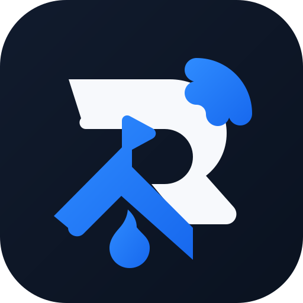

# RCAMP

<p align="center"></p>
<h1 align="center">RCAMP</h1>
<p align="center"><strong>One controller. Many devices. Local by default.</strong></p>
<p align="center">Open-source hardware control for ESP32, Arduino, robots, RC cars, serial devices, and custom targets.</p>
<p align="center"><a href="https://github.com/KiddosTech/RCAMP/releases"></a> <a href="LICENSE"></a>  </p>

RCAMP is a local-first control plane with a shared Rust core. The desktop GUI, Android app, and RCAMP/CLI speak through the same device model instead of duplicating hardware logic.

```text
                ┌── RCAMP GUI ───── Linux · Windows · Android
                │
 rcamp-core ───┼── RCAMP/CLI ───── Linux · Windows
                │
                └── RCAMP/RTOS ──── ESP32 · Arduino · targets
```

No RCAMP cloud account is required for basic operation. Your device can communicate with your computer over Wi-Fi, Bluetooth, USB, or serial.

## Tech Stack

### Website (Next.js + Tabler Design)

The project website is a modern, cool-designed Next.js 15 site with:

| Feature | Description |
| --- | --- |
| **Design Aesthetic** | Dark theme with purple accent, cards with rounded corners, subtle shadows |
| **Layout** | Responsive sidebar on left, main content area on right |
| **Navigation** | Vertical sidebar with tabler icons, topbar with breadcrumb |
| **Components** | Card-based panels with consistent gray-800 / gray-600 theme |
| **Icons** | Tabler.io icons via CDN `data-icon="tabler:name"` syntax |
| **Typography** | `fw-bold`, `text-muted`, `text-primary` color classes |
| **Static Export** | `output: 'export'` in `next.config.mjs` |

The website features Home, About, CLI, and Docs pages with cohesive dark-themed design using Tabler iconography and custom CSS classes.

| Surface | Purpose |
| --- | --- |
| **RCAMP GUI** (Next.js + React + Tabler) | Dashboard with Tabler styling, HQ, Tools, Settings, Plugin, and About tabs |
| **RCAMP/CLI** (Rust) | Command interface and keyboard-first TUI for Linux and Windows |
| **rcamp-core** (Rust) | Shared device manager, profile validation, transport model, and flashing API |
| **RCAMP/RTOS** | Reference ESP32 and Arduino target firmware |

### Application (Tauri/CLI)

The RCAMP application uses Tabler.io design principles:

| Component | Description |
| --- | --- |
| **TUI** | Keyboard-first terminal user interface |
| **CLI** | Rust command interface with terminal output |
| **Desktop GUI** | Built with Tauri + Tabler design system |

The GUI and CLI both leverage the shared `rcamp-core` Rust crate for device management, with Tabler-inspired visual design in the desktop application.

## Installation

The release installers download signed-by-release artifacts and do not require a local Rust installation.

### Windows PowerShell:

```powershell
irm https://raw.githubusercontent.com/KiddosTech/RCAMP/main/scripts/install.ps1 | iex
```

### Linux or macOS:

```sh
curl -fsSL https://raw.githubusercontent.com/KiddosTech/RCAMP/main/scripts/install.sh | sh
# or: wget -qO- https://raw.githubusercontent.com/KiddosTech/RCAMP/main/scripts/install.sh | sh
```

## Development

Install Node.js and a current Rust toolchain:

```sh
npm install
npm run check
npm run build
cargo fmt --check
cargo test -p rcamp-core -p rcamp-cli
cargo clippy --workspace --all-targets -- -D warnings
```

### Android release signing

Pull-request and development builds may use Android's debug signing. Tagged release builds require these GitHub Actions secrets: `ANDROID_KEY_BASE64`, `ANDROID_KEY_ALIAS`, `ANDROID_KEY_PASSWORD`, and `ANDROID_STORE_PASSWORD`. The workflow creates the keystore file only on the runner; no `.jks`, `keystore.properties`, or private credential is stored in the repository.

Start the GUI or CLI locally:

```sh
npm run tauri dev
cargo run -p rcamp-cli --
```

## Repository map

```text
crates/rcamp-core/       Shared Rust device, profile, transport, and flashing logic
crates/rcamp-cli/        RCAMP/CLI parser and TUI
src/                     Next.js + React + Tabler.io GUI
src-tauri/               Tauri desktop/mobile host and commands
rcamp-rtos/              ESP32 and Arduino reference firmware
website/                 Cool-designed Next.js website with Tabler.io
scripts/                 CLI installers
```

## Website

The website is a Next.js static-export site with Home, About, RCAMP/CLI, and Docs routes, designed with a cool dark aesthetic using Tabler.io icons and custom styling. Run `npm install` and `npm run build` inside `website/`, then deploy the generated `website/out/` directory to Cloudflare Pages or GitHub Pages.

## License

RCAMP is licensed under the [Apache License 2.0](LICENSE).